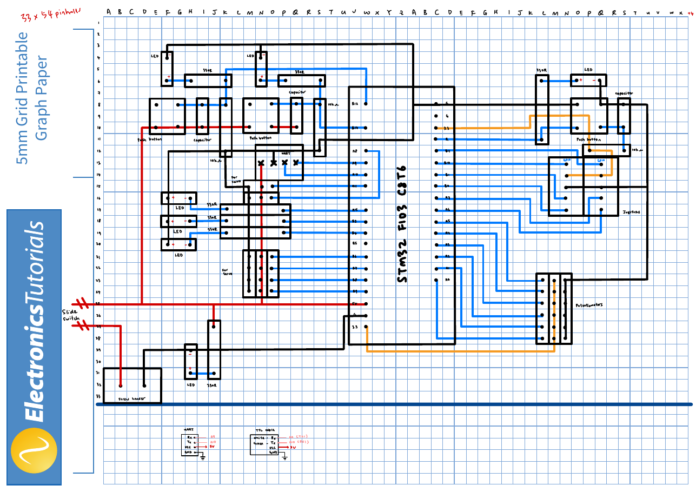
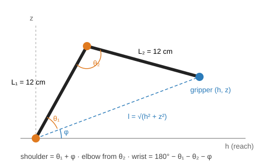

# my-first-robotic-arm

**First place, UTM Robotic Arm Workshop 2025.** A 3D-printed robotic arm controlled by an STM32 "Blue Pill". I wrote inverse-kinematics joystick control for it, so the joystick moves the gripper in x/y/z instead of one joint at a time.

## The workshop and competition

The workshop ran in the style of the UTM Robocon Autocar Challenge, with 12 progressive tasks (Aug–Oct 2025) and a competition at the end. More than 70 students joined the workshop and about 20 competed in the final, which had two games:

- **Game 1, tic-tac-toe:** place balls on a 3 × 3 board using joystick control, with 20-second turns.
- **Game 2, tower stacking:** stack 6 cubes using joystick or potentiometer control.

The full rules are in [`game-rules/`](game-rules), and the task sheets are in [`workshop/`](workshop).

## What I built

| Part | Details |
|---|---|
| Mechanics | 4-DOF arm with gripper, 3D-printed from an open-source design: [DIY Arduino robot arm with smartphone control (Cults3D)](https://cults3d.com/en/3d-model/gadget/brazo-robotico-arduino-diy-con-control-de-smartphone-2023). I printed and assembled the parts. |
| Controller board | STM32F103C8T6 Blue Pill on a hand-planned 33 × 54 perfboard: 6 servo headers, 2 joysticks, 6 potentiometer inputs, RC-debounced push buttons, status LEDs, UART header, screw-terminal power with a slide switch. |
| Firmware | Embedded C in STM32CubeIDE (HAL): inverse kinematics, ADC + DMA joystick sampling, 50 Hz hardware PWM for six servos, UART status output, button-triggered servo calibration sweep. |

### Perfboard layout

The original drawing is in [`notes on electronics and programming/`](notes%20on%20electronics%20and%20programming).

## How the inverse kinematics works

Controlling every joint separately is slow when you have only 20 seconds to place a ball. Instead, the joystick moves a target point (x, y, z), and the firmware works out the joint angles.

1. **Base:** `base = atan2(y, x)`, and the horizontal reach is `h = √(x² + y²)`.
2. **Distance to target:** `l = √(h² + z²)` and elevation `φ = atan2(z, h)`. Targets beyond `L₁ + L₂ = 24 cm` are ignored.
3. **Shoulder and elbow:** the law of cosines on the triangle (L₁, L₂, l) gives
   - `θ₁ = acos((L₁² + l² − L₂²) / 2L₁l)`, so shoulder = `θ₁ + φ`;
   - `θ₂ = acos((L₁² + L₂² − l²) / 2L₁L₂)`, which sets the elbow (with a 225° servo-mounting offset).
4. **Wrist:** `180° − θ₁ − θ₂ − φ` keeps the gripper at a constant pitch while the arm moves.

All angles are clamped to the servo range (0–180°) before being written to the timers. See `moveToPos()` in [`codes/servo.c`](codes/servo.c).

## Firmware overview

| Function | Peripheral | Pins |
|---|---|---|
| Base, shoulder servos | TIM1 CH4, CH1 (50 Hz PWM) | PA11, PA8 |
| Elbow, spare (held at 90°), wrist pitch, gripper servos | TIM4 CH1–CH4 (50 Hz PWM) | PB6–PB9 |
| Joysticks (x, y, z, gripper) | ADC1 IN6–IN9, continuous scan, circular DMA | PA6, PA7, PB0, PB1 |
| Calibration-sweep button | EXTI line 12 | PB12 |
| Status output | USART1, 9600 baud | PA9 (TX), PA10 (RX) |
| Heartbeat LED | TIM2 interrupt | PC13 |

- **Joystick input:** each axis has a 30% deadzone around centre, and its deflection adds a small step to the target coordinate, so holding the stick moves the gripper at a steady speed (`codes/joystick.c`).
- **Control loop:** every 30 ms (about 33 Hz), the main loop runs the inverse kinematics and updates the gripper (`codes/main.c`).
- **Servo PWM:** 72 MHz ÷ 1440 gives 20 µs ticks with a 20 ms period, and 500–2500 µs pulses map to 0–180°.

## Files

- [`codes/`](codes): the source and header files I wrote or changed (`main.c`, `servo.c/.h`, `joystick.c/.h`), plus `roboticArm.ioc` for the pin assignments. CubeIDE generates the rest of the project from the `.ioc`.
- [`docs/`](docs): the perfboard layout and IK diagram.
- [`notes on electronics and programming/`](notes%20on%20electronics%20and%20programming): my hand-drawn layout and notes.
- [`workshop/`](workshop), [`game-rules/`](game-rules): the workshop materials.

## What I would improve

- **Finer servo resolution:** with 20 µs ticks, the 500–2500 µs range gives only 100 steps (1.8° each). A 1 µs tick (prescaler 72 − 1, period 20000 − 1) would give about 0.09° per step.
- **Less work in the ADC interrupt:** the joystick update runs in the ADC complete callback, at roughly 12 kHz, using double-precision maths on a Cortex-M3 with no FPU. Moving it into the 33 Hz loop and using `float` would free most of the CPU.
- **Separate servo power:** the servos share the MCU's 5 V rail. A separate servo supply or a large bulk capacitor would stop current spikes from resetting the board.
